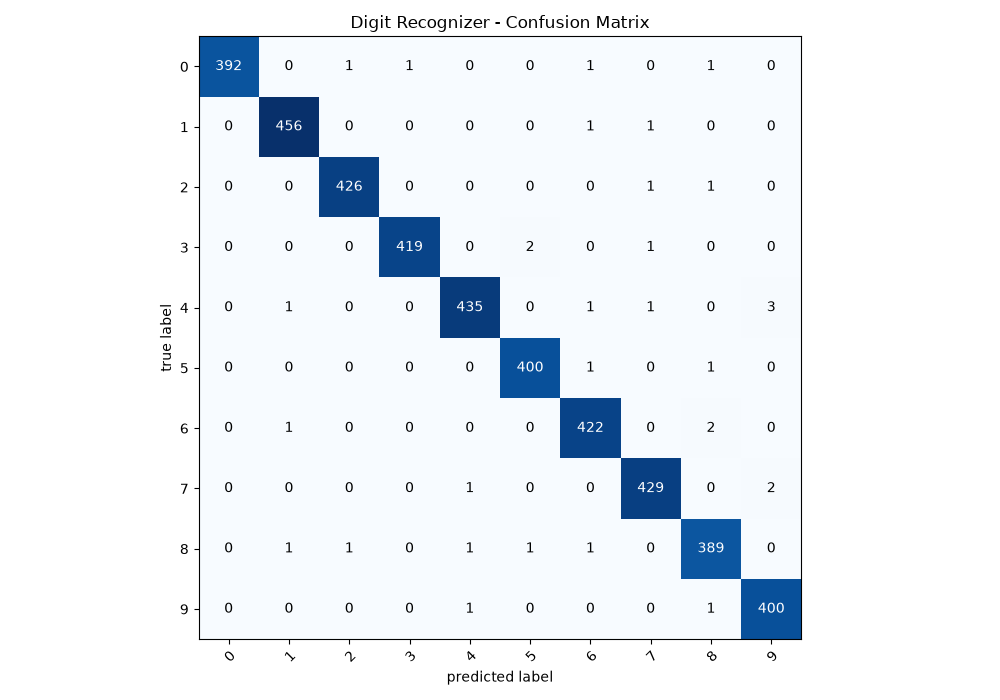
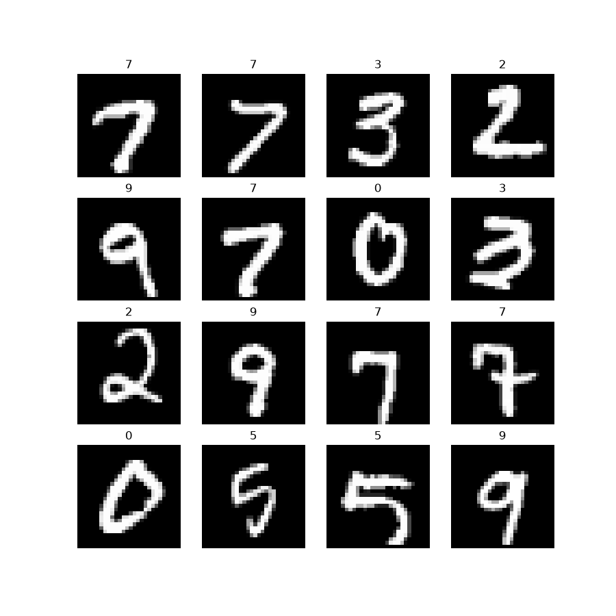

# Digit Recognizer: CNN in PyTorch

A convolutional neural network that classifies handwritten digits (0-9) from 28x28 grayscale images. Built for the Kaggle [Digit Recognizer](https://www.kaggle.com/competitions/digit-recognizer) competition.

## Results

| Metric | Score |
|---|---|
| Test accuracy (held-out 10%, 4,200 images) | **99.24%** |
| Best validation accuracy (4,200 images) | 99.57% |
| Kaggle public score | 0.99507 |

The checkpoint is selected on the validation set only, and the test split is evaluated once after training. The validation score is optimistic because it is the best of 30 epochs. The Kaggle score comes from Kaggle's hidden test set, which is larger than the 4,200-image test split, so it is the less noisy of the two estimates.

## Data

The 42,000 labeled images of `train.csv` are split with a fixed seed (42):

| Split | Images |
|---|---|
| Train | 33,600 (80%) |
| Validation | 4,200 (10%) |
| Test | 4,200 (10%) |

Pixels are scaled to [0, 1]. No mean/std normalization: BatchNorm follows the first convolution, and the augmentation fills new pixels with 0 (the background value).

## Model

About 468k parameters.

```
Conv(1→32)  - BN - ReLU - Conv(32→32) - BN - ReLU - MaxPool
Conv(32→64) - BN - ReLU - Conv(64→64) - BN - ReLU - MaxPool
Flatten - Dropout(0.3) - Linear(3136→128) - ReLU - Dropout(0.3) - Linear(128→10)
```

## Training

- Loss: cross-entropy
- Optimizer: Adam, learning rate 1e-3, cosine annealing over 30 epochs
- Batch size: 32
- Augmentation (train split only): random affine, rotation up to ±10°, translation up to 8%, scale 0.95-1.05, bilinear interpolation
- Checkpoint: best validation accuracy
- Trained on CPU

## Error analysis

32 errors out of 4,200 test images. No class dominates: the most frequent confusion is 4 predicted as 9 (3 cases), and every other pair occurs at most twice.



Random training samples:



## Reproduce

```
pip install -r requirements.txt
```

Download `train.csv` and `test.csv` from the competition page and place them in `digit-recognizer/`. Then:

```
python train.py
python kaggle_submission.py
```

`train.py` trains the model, saves `best_digit_cnn.pth` and the figures in `images/`, and prints the test accuracy. `kaggle_submission.py` loads the checkpoint and writes `submission.csv`. A GPU is used automatically if available.

## Project structure

```
.
├── model.py                # CNN definition
├── train.py                # training, evaluation, figures
├── kaggle_submission.py    # predictions on test.csv
├── best_digit_cnn.pth      # trained weights
├── requirements.txt
└── images/
```

## Limitations

- MNIST-style input only: centered, size-normalized digits. Not tested on real-world handwriting or photos.
- The submitted model was trained on 80% of the labeled data (33,600 of 42,000). It was not retrained on the full set.
- Single run, single seed, no ensembling or test-time augmentation.
- With a 4,200-image test set, differences of around 0.1 point between runs are within noise.
